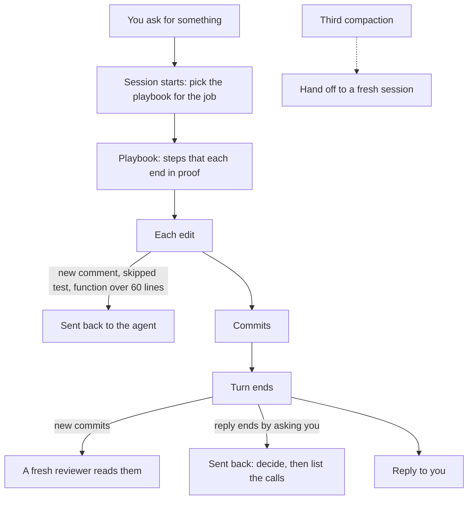

# How kagestack works

kagestack keeps coding agents doing careful work without you watching. Playbooks tell the agent how to do each kind of job. Checks catch the mistakes that a written rule alone doesn't stop.

## Playbooks guide the work

When a session starts, the agent gets a short map from kinds of task to playbooks: a bug goes to `bug-fix`, a new feature to `feature`, and so on. Each playbook is a list of steps, and each step ends in something the agent must show, such as a failing test before the fix. You never type a command. See [Playbooks](playbooks.md).

## Checks catch what text can't

A rule written in a prompt gets skipped when the context fills up. A check runs every time. So when a mistake keeps coming back, it becomes a check, not more text. Hooks send back an edit that adds a code comment, a reply that asks you something it could decide, and commits nobody reviewed. See [What runs on its own](hooks.md), [How work gets reviewed](review.md) and [The ks command](ks-command.md).

## Every change is tested before it ships

A new playbook or rule ships only if a blind test shows that agents do better with it. Some ideas tie and don't ship. See [How a change earns its place](testing-changes.md) and the [changes, release by release](changes.md).
