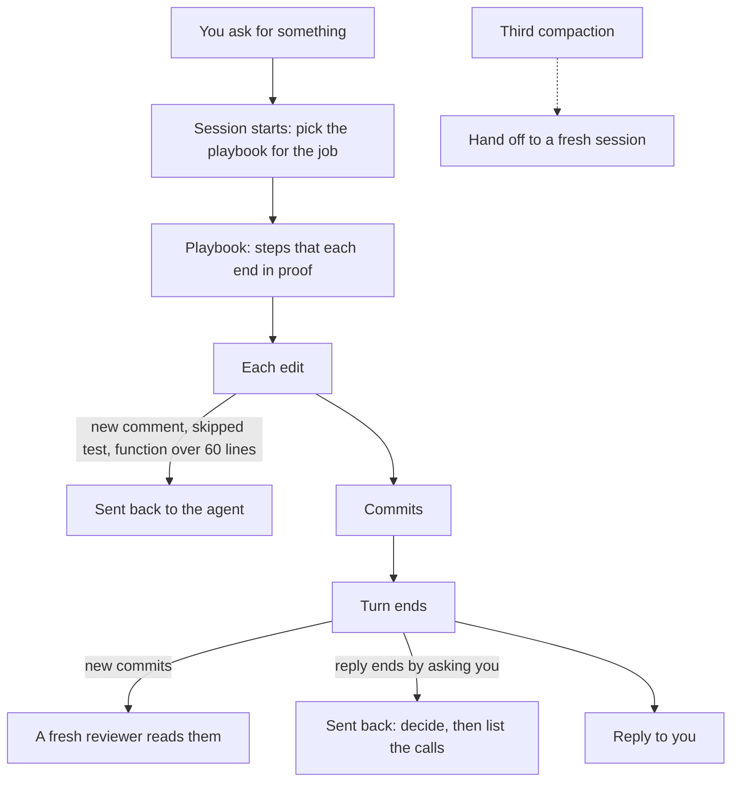

# How kagestack works

One of my Claude Code sessions ran for 24 days and got compacted 153 times. In another, a decision we'd agreed on got undone right after a compaction. kagestack is the set of habits and guard rails I built so agents do careful work even when nobody's watching that closely.

## Playbooks guide the work

Think of a good kitchen: nobody re-invents how to make the stock each morning, there's a card on the wall. A playbook is that card for one kind of job. When a session starts, the agent gets a short map, so a bug goes to `bug-fix`, a new feature to `feature`, and so on. Every step ends in something the agent has to show, like a failing test before the fix. You never type a command. See [Playbooks](playbooks.md).

## Checks catch what text can't

A rule in a prompt is a sticky note. It works until the context fills up and the note falls off. A check runs every single time. So when a mistake keeps coming back, it becomes a check, not more text. Hooks send back an edit that adds a code comment, a reply that asks you something the agent could decide, and commits nobody reviewed. See [What runs on its own](hooks.md), [How work gets reviewed](review.md) and [The ks command](ks-command.md).

## Every change is tested before it ships

I don't trust a rule just because it sounds right. A new playbook or rule ships only if a blind test shows agents actually do better with it, and some of my ideas tied and never shipped. See [How a change earns its place](testing-changes.md) and the [changes, release by release](changes.md).
