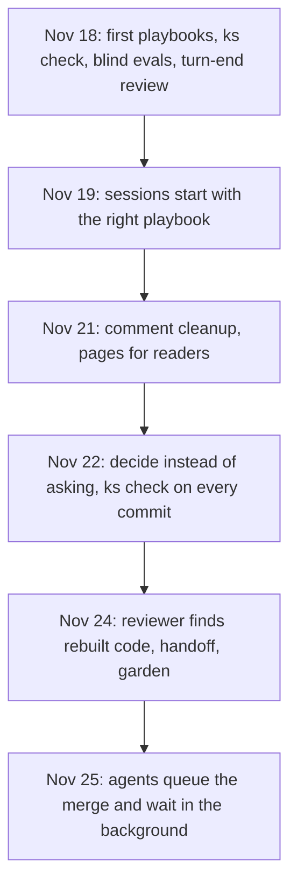

# Changes, release by release

kagestack changes almost every day, and I kept losing track of why. So each release here says what you or an agent saw before it, what changed, why, and the test behind it. The ideas that tied in a blind test are here too, marked as not shipped, because a failed idea is still worth remembering.

## 0.33.2 · Nov 25 · The wait check reads shell quoting the way bash does

- **Before:** 0.33.1 stripped quotes with a regex. A comment like `# it's here` or an escaped quote fooled it and hid a real `gh run watch`. A 20 KB unclosed heredoc made every shell command wait 2 seconds, and 50 KB took more than 8.
- **After:** A small scanner reads quotes, escapes and comments the way bash does, in one pass. Loop words inside a commit message or a heredoc no longer trip the check. A wait inside `bash -c "..."`, an `if` block, braces, backticks, an `env` prefix, `gh -R` or `gh pr checks -w` is caught. The code is split into simple commands first, and each one is matched from its start, so the check takes time in line with the command's length.
- **Why:** A fresh reviewer found both in 0.33.1. Python's `shlex` was the first choice, but it drops the newline that ends a comment, so two commands read as one. Three later reviews each found one more slow input for a single regex over the whole command, which is why the split came in.
- **Proof:** No eval. Each case has a test that failed before the fix. A fuzz of 1,001 commands of 50 KB, made from every separator, prefix and command pairing, finished in at most 0.25 seconds each. The slowest one took 0.18 seconds at 200 KB.

## 0.33.1 · Nov 25 · A commit message that mentions watch runs

- **Before:** The wait check refused a commit message or heredoc with a line like `x; watch tests`. A `time` or `sudo` prefix hid a real `gh run watch`.
- **After:** Quoted text and heredoc bodies are ignored when the check looks for a watch command. A `sudo`, `time`, `timeout N` or `VAR=value` prefix no longer hides one.
- **Why:** A fresh reviewer found both cases in 0.33.0.
- **Proof:** No eval. Each case has a test that failed before the fix.

## 0.33.0 · Nov 25 · A foreground wait loop is sent to the background

- **Before:** An agent waited for a staging deploy with a `for` loop that slept 15 seconds between checks. The session sat frozen for 2 minutes 22 seconds. Claude Code blocks a bare foreground `sleep`, but it lets the same `sleep` run inside a loop.
- **After:** A new hook runs before each shell command. It sends back a foreground loop that sleeps, `gh run watch`, `gh pr checks --watch` and `watch`. The reason it gives names the better tool: run in the background, or wait with Monitor.
- **Why:** The owner's rule "never block on a wait" lived only in text, and the agent skipped it at the exact moment it mattered.
- **Proof:** No eval. One headless session, shown in the pull request: the wait loop was refused, and the agent moved the wait to the background.

## 0.32.1 · Nov 25 · Queue a merge only where the repo allows auto-merge

- **Before:** On a repo that does not allow auto-merge, `gh pr merge --auto` merged the pull request at once, before CI finished, wherever branch rules required no checks.
- **After:** The `pr` playbook reads the repo's `allow_auto_merge` first, and passes `--auto` only when it is on.
- **Why:** A pull request merged 2 minutes before its CI passed, on the day 0.32.0 shipped.
- **Proof:** No eval. Seen on one pull request.

## 0.32.0 · Nov 25 · Agents queue the merge instead of waiting on CI

- **Before:** After opening a pull request, a session sat and polled CI until it could merge, and a long CI run stalled the whole task.
- **After:** The `pr` playbook queues the merge with GitHub's auto-merge (`gh pr merge --auto`) and moves on. GitHub merges once the required checks and reviews pass.
- **Why:** The polling loop was one of four stall causes in the owner's Nov 24 retro.
- **Proof:** No eval. The `pr` eval runs in a local repo with no GitHub, so it cannot reach a merge.

## 0.31.0 · Nov 24 · A docs site explains each hook, playbook and release

- **Before:** The reason for each change lived only in commit messages and an eval table. Two features merged without a version bump, so installed copies missed them for about 2.5 hours.
- **After:** aloki-alok.github.io/kagestack explains what runs, how review works, and why each release shipped. A test fails a release that has no entry on this page.
- **Why:** The owner wants to understand each change without reading commits.
- **Proof:** No eval.

## 0.30.0 · Nov 24 · Agents find the mistakes a repo keeps repeating

- **Before:** Review caught the same repeated mistake by hand, and nothing read a repo's own fix history.
- **After:** The `garden` playbook reads fix commits, reverts and review comments, groups them by mistake, and adds a check for each repeated one.
- **Why:** Old bad code keeps teaching new code the same mistakes, and no part of kagestack learned from a repo's own history.
- **Proof:** When the ask names the mistake, agents guarded the old bugs 10/10 vs 10/10 and cited 2 past fixes 8/10 vs 3/10. When it does not, guard catches the old bugs 5/5 vs 2/5, cited past fixes 5/5 vs 0/5, cost 1.16x. "The old code here is bad" went to `refactor` 0/5 vs 0/5.

## Tried, not shipped: read the ask first (Nov 24)

- **Before:** Agents sometimes read "see how we can reuse" as a request for advice, not a build.
- **After:** Session text that makes the agent read the ask first tied with 0.29.0 on every outcome, so it did not ship.
- **Why:** In RESULTS.md, Sonnet already picks the likely job and keeps scope on these asks. A retest needs real past asks that agents got wrong.
- **Proof:** Right fix or cause 10/10 vs 10/10, no added work 14/15 vs 13/15, named its reading 5/10 vs 6/10, expert word glossed 9/10 vs 9/10, raw log quoted 4/5 vs 5/5, cost 1.0x.

## 0.29.0 · Nov 24 · Review finds rebuilt code, and long sessions get a handoff

**The reviewer looks for code that already did the job**

- **Before:** The end-of-turn review passed new code that rebuilt something the repo already had.
- **After:** The reviewer searches for each new piece. A duplicate becomes a finding that names the existing code's file and line.
- **Why:** In two days, review passed three changes that rebuilt something the repo already had.
- **Proof:** No eval.

**Agents get a handoff prompt after the third compaction**

- **Before:** One session ran 24 days and was compacted 153 times, and agreed decisions got undone after compactions.
- **After:** After the third compaction, the agent finishes its step, runs the handoff playbook, and points the owner to a fresh session.
- **Why:** Each compaction drops about 440k tokens to a summary, and 31 of 244 sessions in the last week passed three.
- **Proof:** No eval.

## 0.28.1 · Nov 23 · Component tests pass `ks check`

- **Before:** `ks check` sent back the `@vitest-environment jsdom` line at the top of a component test as a new comment.
- **After:** `ks check` treats that line, and the `@jest-environment` form, as a runner directive.
- **Why:** A frontend repo with 44 such files couldn't take a new component test without a workaround.
- **Proof:** No eval.

## 0.28.0 · Nov 22 · Agents cannot hide a failing test or grow a function past 60 lines

- **Before:** Agents skipped a failing test, or piled new logic into one function, and `ks check` let both through.
- **After:** `ks check` sends back a new unconditional skip or focus, and any function this change pushes past 60 lines.
- **Why:** Agents hide a failing test by skipping it. Old long functions can still change, so small fixes in old code stay unblocked.
- **Proof:** No eval.

## 0.27.1 · Nov 22 · The git hook explains a read-only git config

- **Before:** `ks git-hook` crashed with a traceback when Nix home-manager owned the git config.
- **After:** It prints git's error and the `core.hooksPath` line to add by hand. A rerun then only refreshes the hook scripts.
- **Why:** A config managed by home-manager is a read-only symlink, so `git config --global` fails.
- **Proof:** No eval.

## 0.27.0 · Nov 22 · Commits run `ks check`, for any agent

- **Before:** `ks check` ran only in CI, and the repos I work in didn't have that job. One of three retry tasks still committed a comment.
- **After:** A hook checks each file Claude edits. `ks git-hook` checks staged lines on every commit, for any agent or person.
- **Why:** Nothing checked comments during a session, and the edit hook only reaches Claude Code.
- **Proof:** No eval.

## 0.26.0 · Nov 22 · Agents decide instead of asking for a plain "go ahead"

- **Before:** An agent ended its reply with a question, and the owner answered "go ahead".
- **After:** `decide.py` blocks such a reply once. The agent keeps the question for a one-way door, otherwise acts and lists the calls it made.
- **Why:** In seven days, 194 of 1,454 human turns answered a closing question, and at least 39 were a plain "go ahead".
- **Proof:** No eval.

## 0.25.0 · Nov 21 · Explain pages shrink to outcomes and approach

**List rows show a name and a before and after outcome**

- **Before:** Each row of an ideas page hid its code but still carried two sentences of explanation.
- **After:** Each row shows a name and a before to after outcome line.
- **Why:** The owner chose the outcome line over a tiny picture, because every item has one and not every item draws well.
- **Proof:** Outcome phrase on 80% of rows 5/5 vs 0/5, rows of 30 words or fewer 5/5 vs 3/5, all items kept 5/5 vs 5/5, cost 1.06x.

**An opened row shows Now and Fix flows**

- **Before:** Opening a row gave a paragraph and a sentence about a file path.
- **After:** An opened row shows short Now and Fix step flows with file and line chips.
- **Why:** The owner skipped the paragraphs. Short flows carry the same facts at a glance.
- **Proof:** Now and Fix steps 5/5 vs 0/5, words per opened row 27 vs 75, all tickets and locations kept 5/5 vs 5/5.

**No evidence and no dropdowns on the page**

- **Before:** Evidence sat behind a click, which still cost a row of noise.
- **After:** A page holds only what is broken or missing, the approach and what gets built. Code locations and tickets stay in the repo.
- **Why:** The owner does not open dropdowns, and hidden evidence taught nothing.
- **Proof:** Nothing hidden 5/5 vs 0/5, no ticket ids or file paths 5/5 vs 0/5, median 172 vs 255 words, cause, fix and feature visible 4/5 vs 3/5.

**Each item picks its form from its content**

- **Before:** One Now and Fix arrow chain was stamped on every item, and the owner could not read it.
- **After:** An item shows a screen mock when the change is visible, a number when it is a number, otherwise one plain sentence each.
- **Why:** The arrow chains were one template forced on every item.
- **Proof:** No code names 5/5 vs 5/5, screen changes as mocks 5/5 vs 0/5, real numbers kept and gaps marked 5/5 vs 0/5, no arrow chains 5/5 vs 0/5, cost 1.09x.

**Each item says why it matters, measured or marked a guess**

- **Before:** The owner could not tell from an ideas page whether any item was worth building.
- **After:** Items carry how often each problem hits customers. A page without that number says so instead of recommending.
- **Why:** Nothing counted how often each problem hit customers.
- **Proof:** No eval.

**Reverted: concept pages built up in steps**

- **Before:** Concept pages did not draw pictures one part at a time.
- **After:** The step-by-step change was dropped and the skill went back to the version that passed.
- **Why:** No run of five built pictures up, and concept pages grew from a median of 237 to 850 words.
- **Proof:** Pictures built up 0/5 vs 0/5, plain definition first 2/5 vs 0/5, median 850 vs 237 words, cost 1.4x, not shipped.

## 0.24.0 · Nov 21 · Agents write one-screen pages for readers

- **Before:** Agents put everything they found on a page, so readers got fourteen sections and ten tables and read none.
- **After:** The `explain` playbook picks the route first, writes the answer in five lines, and caps the visible page at one screen.
- **Why:** Agents treat a page as the place to put everything they found.
- **Proof:** Short page 9/10 vs 0/10 (median 284 vs 1,310 words), one diagram 4/10 vs 0/10, all decisions and key facts kept 10/10 vs 10/10, cost 1.0 to 1.5x.

## 0.23.0 · Nov 21 · Comment cleanup keeps decisions and hacks

- **Before:** Deleting a "why we chose X" comment lost the decision, and an out-of-scope hack was only listed in the reply.
- **After:** A decision comment becomes an ADR in the repo's decision folder. A hack comment opens an issue that names the fix at its source.
- **Why:** In a smoke run the reviewer turned a hack into a helper. The hack stayed and no issue opened.
- **Proof:** No eval.

**`ks check` prints the size of a cleanup**

- **Before:** `ks check --all` on an old repo gave no sense of the cleanup size.
- **After:** The run ends with "N comments on M lines".
- **Why:** The count sizes the cleanup before anyone starts it.
- **Proof:** No eval.

**`scout` says to pin tests before a new linter's autofixes**

- **Before:** A new linter's autofixes could change code with no test to catch it.
- **After:** `scout` tells the agent to pin tests first.
- **Why:** A published monorepo migration hit oxlint fixes that renamed a destructured key and broke a React Native alias.
- **Proof:** No eval.

## 0.22.0 · Nov 21 · Old comments get a verdict, and bare suppressions fail

**Agents clear old comments with a fresh reviewer**

- **Before:** `ks check` stopped new comments, but old comments in touched code stayed, and deleting one lost what it warned about.
- **After:** The `clear-comments` playbook hands each comment to a read-only agent. Each gets a verdict: delete, reshape, encode as a test, or keep with proof.
- **Why:** Deleting a comment loses whatever it was warning about, so an agent that did not write it judges each one.
- **Proof:** No eval.

**`ks check` fails suppressions that name no rule**

- **Before:** A bare `noqa`, `type: ignore` or `@ts-ignore` silenced every check on that line.
- **After:** `ks check` fails them on new lines and asks for the rule name. Scoped forms still pass.
- **Why:** A bare suppression also hides the checks that catch real bugs.
- **Proof:** No eval.

## 0.21.0 · Nov 19 · Agents check a web page on phones and in every browser

- **Before:** Agents testing a web change wrote their own Playwright scripts, each with a different device list and no layout check.
- **After:** `ks screens` opens a page on 7 screens, saves a screenshot of each, and lists sideways scroll and its causes.
- **Why:** Agents kept writing their own scripts, so one tool replaces them.
- **Proof:** No eval.

## 0.20.0 · Nov 19 · Each session starts with the matching playbook

- **Before:** A fresh session had the playbook routes in its CLAUDE.md and still did not load `kagestack:bug-fix` until asked.
- **After:** A SessionStart hook points each session at the matching playbook. A one-line edit or a one-file lookup may skip it.
- **Why:** Skill descriptions alone do not make the model reach for a playbook.
- **Proof:** No eval.

## 0.19.1 · Nov 18 · A fresh reviewer checks new commits when a turn ends

**Interactive turns end with one fresh review**

- **Before:** Nobody reviewed the commits a turn left behind unless the owner asked.
- **After:** A Stop hook asks Claude to start one fresh reviewer on unreviewed commits. `KS_REVIEW=0` turns it off.
- **Proof:** No eval.

**Eval runs ignore the author's own instruction files**

- **Before:** Eval runs loaded the author's `~/.claude` files on both sides, so "without" was not plain Claude.
- **After:** Both sides run with those files excluded.
- **Why:** A probed run knew the author's name and quoted the global file's heading.
- **Proof:** RESULTS.md says every run before 2026-11-19 loaded those files on both sides.

## 0.18.1 · Nov 18 · `ks` help and output read cleanly

- **Before:** `ks` help and output were long and uneven.
- **After:** Help lists commands in the order you use them. Every command ends on one result line, and a step left for you starts with `next:`.
- **Proof:** No eval.

## 0.18.0 · Nov 18 · Playbooks reach Codex and OpenCode

- **Before:** `uvx` installs only `src/ks`, so `ks` could not hand the playbooks to other clients.
- **After:** `ks package` writes the playbooks for Codex and OpenCode, each with a `kagestack-` prefix and its own `principles.md`.
- **Why:** Both clients find skills in `.agents/skills` on their own. `--check` fails on drift, and `ks doctor` warns on a stale copy.
- **Proof:** No eval.

## 0.17.0 · Nov 18 · `ks doctor` checks the setup

- **Before:** Nothing said whether `kagestack.toml` was complete or the CI workflow ran a real release.
- **After:** `ks doctor` reports both. A pin that is no release fails, and an older release warns.
- **Proof:** No eval.

## 0.16.0 · Nov 18 · `ks setup` and `ks ci` write and run the repo's checks

- **Before:** Each repo wired its own checks by hand.
- **After:** `ks setup` drafts `kagestack.toml` from commands it can trace to a file. `ks ci` runs them in order, then `ks check`.
- **Why:** An empty test command fails, so a repo cannot go green without naming its tests or saying "none".
- **Proof:** No eval.

## 0.15.0 · Nov 18 · Agents learn when a faster tool exists

- **Before:** Agents kept the old standard tool without checking for a newer one.
- **After:** `ks tools` names each older tool in a repo with its faster, maintained swap. The `scout` playbook covers categories the list misses.
- **Why:** The list's release dates were checked on GitHub on 2026-11-18. On a typical frontend repo it names eslint, husky and npm.
- **Proof:** No eval.

## 0.14.0 · Nov 18 · CI is pinned and worker rules reach only worker agents

- **Before:** A moved CI action tag could change what runs, and worker rules also reached custom agents such as reviewers.
- **After:** CI actions are pinned by commit. The hook matches only plain worker agents, `pyproject` and `plugin.json` share one version, and `ks --version` prints it.
- **Why:** Custom agents bring their own prompt.
- **Proof:** No eval.

## 0.13.0 · Nov 18 · The playbooks stop contradicting each other

- **Before:** Playbooks and worker rules disagreed. For example, `pr` asked every commit to pass while `bug-fix` commits a red test first.
- **After:** `pr` drops that ask, `feature` lists what it passed, and `handoff` commits your work, not everything, so secrets stay local.
- **Proof:** No eval.

## 0.12.0 · Nov 18 · Fixes cover every form of the fault

**Agents fix every form of the fault**

- **Before:** "Smallest change" stopped short. An Excel CSV fix left CRLF in 6/6 runs while plain Claude fixed both.
- **After:** The principle is the smallest change that fixes every form of the fault. Size matters after the whole fault is listed.
- **Why:** Two blind evals found the smallest change stopped short.
- **Proof:** Hidden tests 39/40 vs 37/40 in the third blind eval, so the loss is gone but correctness did not win. Cost 1.4x.

**A moved comment is not a new comment**

- **Before:** Splitting a module failed CI because every moved comment counted as new.
- **After:** A comment counts as new only if no removed line in the same diff ends with its text.
- **Why:** The failure pushed agents to delete good comments.
- **Proof:** No eval.

**The README fits one screen**

- **Before:** The README was long, with eval tables inside it.
- **After:** It says what the plugin does in one screen, and eval tables live in `evals/RESULTS.md`.
- **Proof:** No eval.

## 0.11.0 · Nov 18 · `bug-fix` keeps what callers rely on

- **Before:** The `bug-fix` playbook changed the bad-input error in 8/10 runs.
- **After:** Step 3 keeps the return type, raised errors and bad-input handling, and checks bad input before and after. Evals now go blind first.
- **Why:** A blind eval found the smaller fix changed the error from `ValueError` to `InvalidOperation`. My own evals rewarded my own steps twice.
- **Proof:** Hidden tests 24/40 vs 28/40, a proven red test 39/40 vs 8/40, cost 1.6x. The plugin left CRLF unfixed in 6/6 runs.

## 0.10.0 · Nov 18 · Evals score outcomes on a clean setup

- **Before:** The baseline loaded the author's whole `~/.claude` setup, and facts mostly copied playbook steps.
- **After:** Both sides run with no user CLAUDE.md, skills, plugins or hooks. Facts check outcomes a user would check, and traps were added.
- **Why:** A critic found kagestack won by definition when facts copied its own steps. The old baseline ran the author's wrap-up skill.
- **Proof:** No eval.

## 0.1.0 to 0.9.0, Nov 18: the first playbooks

- **Plugin foundation (0.0.1):** README with the bar, MIT license and the manifests that let Claude Code install the repo. The README says how kagestack heals: an agent fixes its failing check, and a repeated mistake becomes a check.
- **`bug-fix` playbook (0.1.0, 0.1.1):** Six steps from a red repro to a proven fix, each ending on a done-when line. The repro must be fast and deterministic. Author-built eval: both pages fixed 5/5 vs 0/5.
- **Worker rules for every subagent (0.2.0):** A SubagentStart hook injects `hooks/worker.md` into each subagent, so no brief has to remember it.
- **`feature` playbook (0.3.0):** Nine steps from restating the goal to flagging old code the work passed. Later versions file each flag as an issue after searching open ones.
- **Shared principles (0.4.0):** One file of design, verification and working principles that the playbooks read before step 1.
- **`refactor` playbook (0.5.0):** Seven steps that change structure and keep behavior, pinning current behavior in its own commit first. Author-built eval: 5/5 vs 5/5.
- **`investigate` playbook (0.6.0):** Read-only answers to how and why questions. Author-built eval with a wrong premise: 5/5 vs 5/5.
- **`perf` playbook (0.6.0):** Measure before and after, and tie every change to a number. Author-built eval: 45x faster vs 95x faster.
- **`eval` playbook and `evals/run.py` (0.6.0, 0.8.0):** Test a skill change on a trap task before shipping it. `run.py` copies a small repo per run and scores with plain code.
- **`handoff` playbook (0.7.0):** A 10-line wip note a fresh agent can start from. Author-built eval: pushed with the note 5/5 vs 2/5.
- **Each rule said once (0.7.0):** Worker rules keep only what every subagent needs. Playbook rules live once in `principles.md`.
- **`pr` playbook (0.8.0):** Fill the repo or org pull request template, else write a one-minute briefing. Author-built eval: template filled 5/5 vs 0/5.
- **`ks check` (0.8.0, 0.9.0):** The first check that runs as code. It fails new comments and docstrings, lets tool directives through, and prints a clean line when the change is clean.
- **Evals for each playbook (0.8.0, 0.9.0):** Evals for `pr`, `feature-flags`, `bug-fix`, `refactor`, `perf`, `handoff`, `investigate` and babysit. Author-built `feature-flags`: 5/5 vs 5/5.
- **Babysit tried, not shipped (0.9.0):** The babysit playbook tied a plain agent on every fact, so it did not ship. Its eval is the bar for the next try.
- **README and test setup (0.9.0):** The README says how to stay updated, how to run evals, and what enforces each rule. `pytest` collects only `tests/`, not the eval fixture repos.
