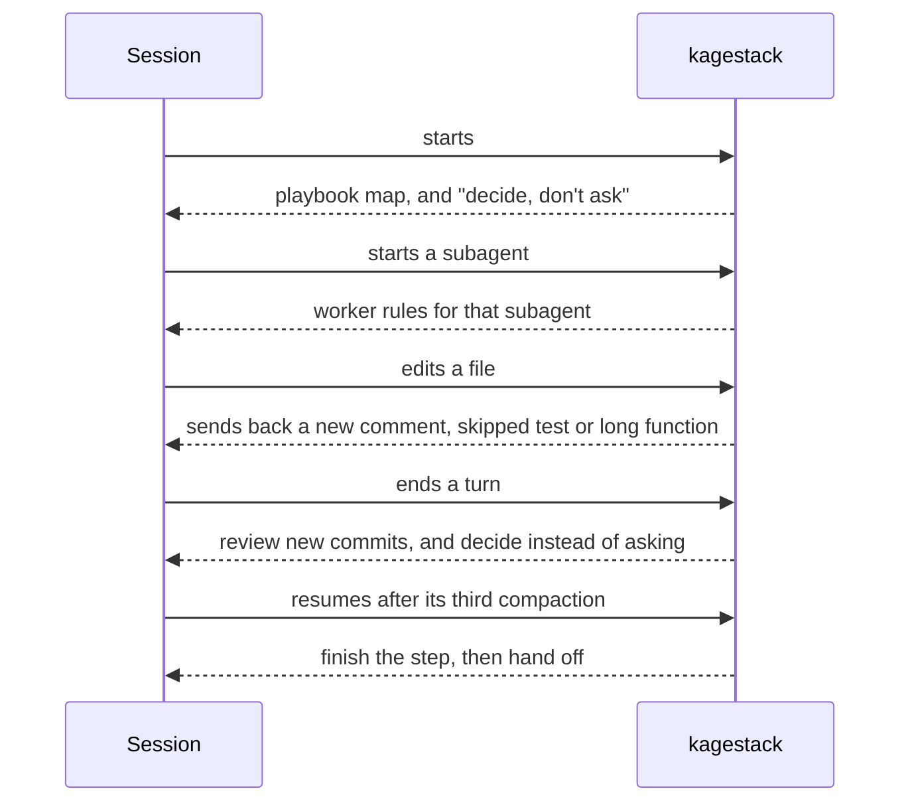

# What runs on its own

Six hooks run inside every Claude Code session that has kagestack installed, kind of like the checks a pilot runs without thinking about them. You never type anything. Each hook either adds a short note to what the agent reads, or sends its work back with the reason.

## When a session starts

The agent reads the map from kinds of task to playbooks, so it picks up the right one without being asked. The same note tells it to decide instead of asking you, because a pile of "should I go ahead?" questions is pretty much the opposite of help. It asks only before a deploy, a production write, money, a migration, a delete it can't undo, or a message to people.

## When a subagent starts

A plain subagent gets the worker rules: do the job in its brief, back every claim with a command and its output, and stop after the third failed try on one idea. Named agents with their own instructions are left alone.

## After each edit

An edit that adds a code comment, skips a test, or grows a function past 60 lines is sent back. The agent puts the reason in a name, a test or the commit message instead. `ks check` applies the same rule to a whole branch.

## When a turn ends

If the turn made commits that nobody reviewed, the agent starts a fresh reviewer before it may finish. See [How work gets reviewed](review.md). If the reply ends by asking you something it could decide, it is sent back to decide and list its calls.

## After the third compaction

Once a session you watch has been compacted three times, it keeps only summaries of its early decisions. The agent is asked to finish its step, write a handoff and tell you to continue in a fresh session. `KS_HANDOFF_AFTER` sets the count.
