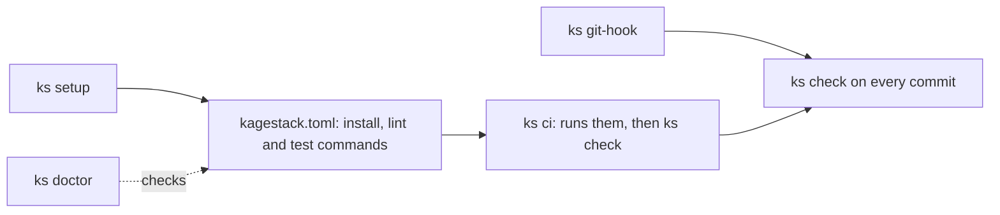

# The ks command

`ks` is the command-line half of kagestack. Hooks only live inside Claude Code, so `ks` carries the same checks into CI and to any other agent, Codex included.

Install it with `uv tool install git+https://github.com/aloki-alok/kagestack`.

## Checks

- `ks check` fails a branch that adds a code comment, a lint suppression that names no rule, a skipped test, or a function grown past 60 lines. `ks check --all` counts what is already there.
- `ks git-hook` runs `ks check` on each commit you make, in every repo on the machine that has no git hooks setup of its own. It skips merges, cherry-picks and reverts, and lets a commit through with a note when `ks` is not installed.

## Setting up a repo

- `ks setup` finds the repo's install, lint and test commands and writes them to `kagestack.toml`, with a CI job pinned to this release. It shows both files and asks first. It never guesses a test command.
- `ks ci` runs those commands in order, then `ks check`. That is the CI job.
- `ks doctor` says whether the setup is complete and whether CI runs a current release.

## Helpers

- `ks stuck` lists your open pull requests that can't move, with the reason and who moves each one next: an agent or a person. `--org <name>` covers a whole org.
- `ks tools` names faster, maintained replacements for old dev tools, such as ruff for flake8.
- `ks screens <url or file>` screenshots a page on phones, a tablet and desktops in Chromium, WebKit and Firefox, and lists sideways scroll, page errors and console errors.
- `ks package` copies the playbooks to `.agents/skills`, for Codex and OpenCode.
