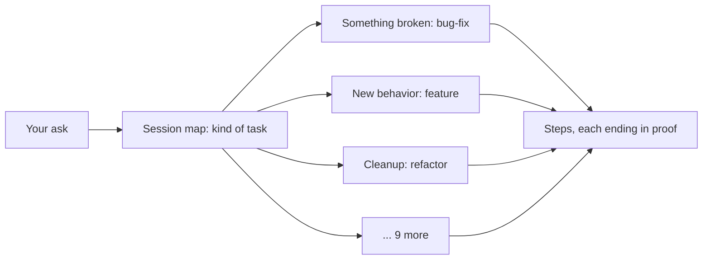

# Playbooks

A playbook is a short list of steps for one kind of job. Each step ends in something the agent must show before it moves on, so "done" means proven, not claimed. The session map picks the playbook from what you asked, and the agent loads it by itself.

The seven playbooks that change code or test a change also read the shared principles first: delete before adding, use what exists, prove it on the real thing, and fix the cause where it first went wrong. The list below comes straight from each playbook's own file, so it always matches what agents read.

{{playbooks}}
