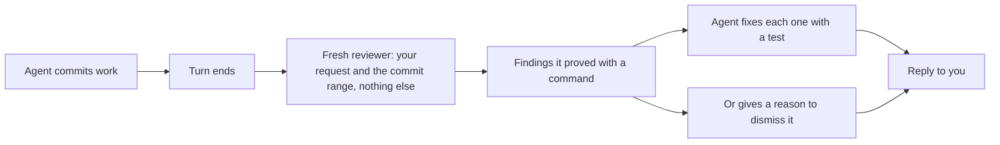

# How work gets reviewed

Every commit an agent makes in a session you watch gets read by a second agent before the turn ends. The reviewer gets your request and the commit range, and none of the first agent's reasoning, so it reads the work cold.

## What the reviewer looks for

1. Bugs a user would hit: wrong output, a crash, lost data, a security hole, a caller that breaks.
2. Code that already did the job. Two pieces of code for one job is a finding. The fix is to reuse the old code, or to move its callers to the new code and delete the old.
3. Weak tests. Each new test must fail when the behavior breaks, and still pass when the code is restructured with the same output.
4. The one fact the change is safe because of, and how far it is proven.

It reports only findings it confirmed by running something.

## When it runs, and when it doesn't

It runs once per turn that adds commits, after the work, not alongside it, because it judges the finished commits. It skips headless runs, turns that still have background work going, and work that isn't a commit: replies, messages and uncommitted edits get no reviewer. `KS_REVIEW=0` turns it off, and `KS_REVIEW=1` turns it on where Claude Code can't tell if you are watching.
