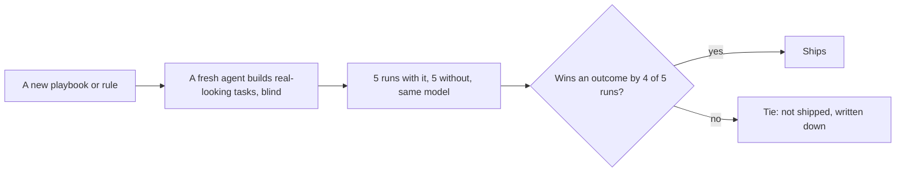

# How a change earns its place

A change to a playbook or a rule ships only when agents measurably do better with it. Text that changes nothing still costs every session that reads it.

## The agent that wrote it doesn't test it

The author knows what the change is meant to do, and would build tasks it passes. So a fresh agent that never reads the change builds the test. It gets the goal in plain words, the two versions to compare, and a budget.

## Tasks look like real work

Each task is a small repo with a git history and a short ask, typed the way a person types. Nothing in it says test or eval, because an agent that knows it is being tested behaves differently. Before any run, the tester writes the outcomes a user would check, such as "the bug is gone" or "no unrelated file changed", and a script scores them.

## A tie doesn't ship

Each version runs 5 times per task. A version wins an outcome only when it leads by at least 4 of 5 runs. A smaller gap is a tie, and a tie at the same cost doesn't ship. Every result is written down, including the ties, so the same idea isn't tried twice. See the [changes, release by release](changes.md).
