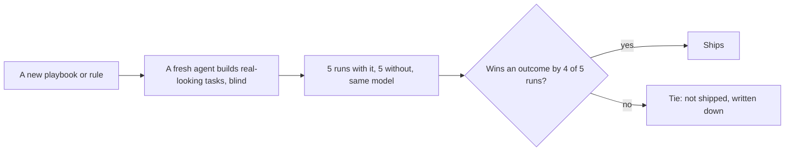

# How a change earns its place

Every line of a playbook gets read in every session, so a rule that changes nothing isn't free. It's a small tax forever. That's why each change has to prove itself before it ships.

## The agent that wrote it doesn't test it

If you write the exam for your own essay, you'll pass. So the agent that made a change never builds its test. A fresh agent that hasn't read the change gets the goal in plain words, the two versions to compare, and a budget, and builds the test from there.

## Tasks look like real work

Each task is a small repo with a git history and a short ask, typed the way a person actually types. Nothing in it says test or eval, because an agent that knows it's being watched behaves differently (people do too!). Before any run, the tester writes down what a user would check, like "the bug is gone" or "no unrelated file changed", and a script scores it.

## A tie doesn't ship

Each version runs 5 times per task. A version wins an outcome only when it leads by at least 4 of 5 runs. Anything closer is a tie, and a tie at the same cost doesn't ship. Every result gets written down, ties included, so nobody tries the same idea twice. See the [changes, release by release](changes.md).
